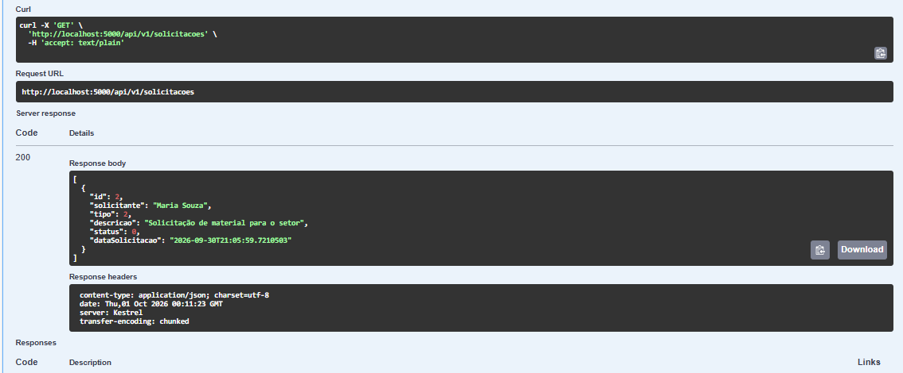
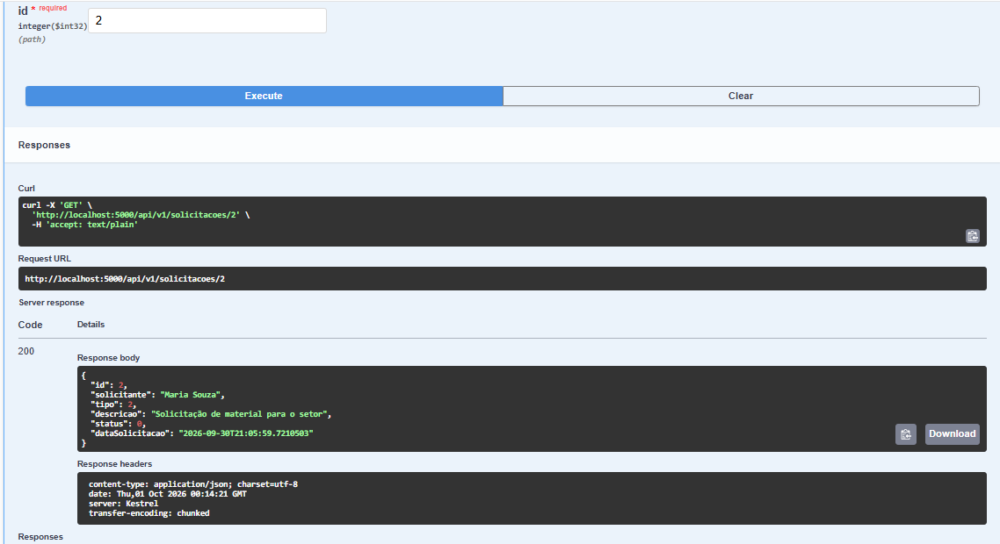
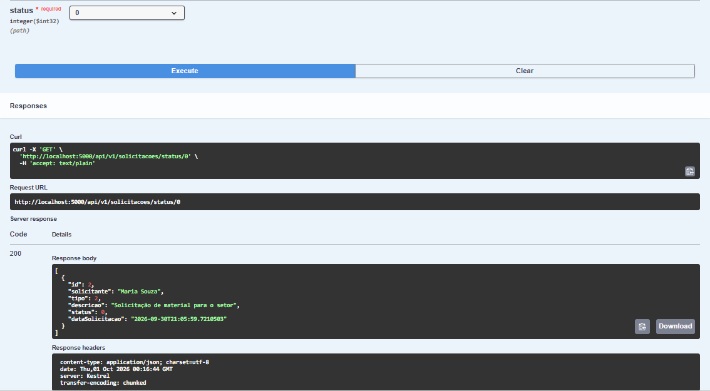
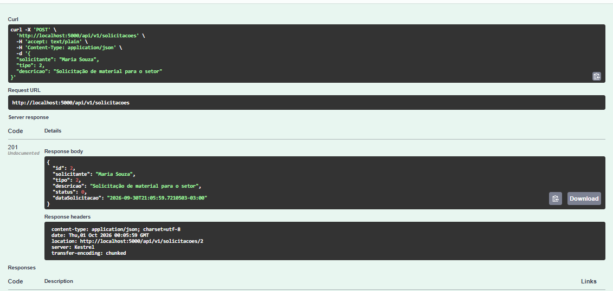
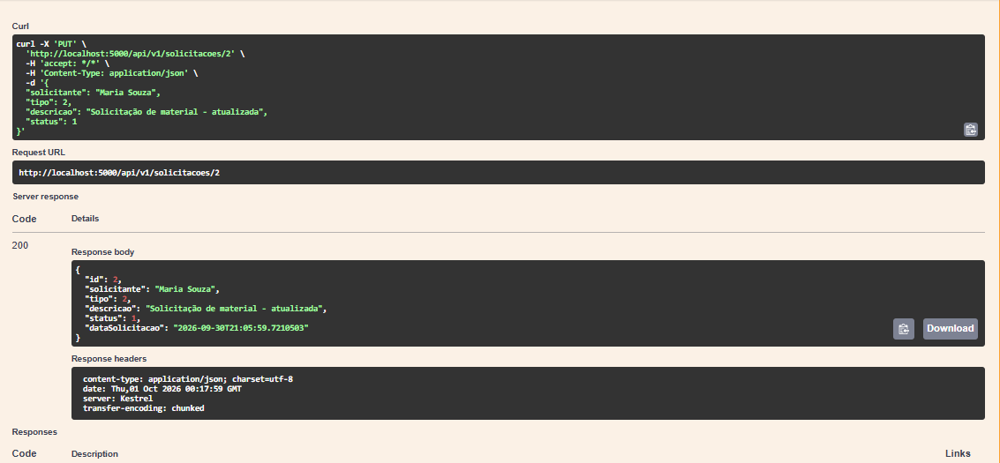
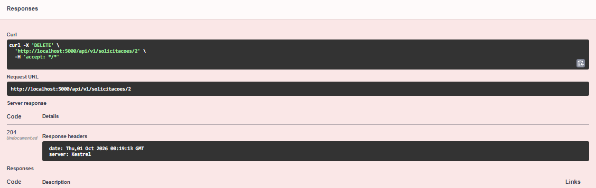
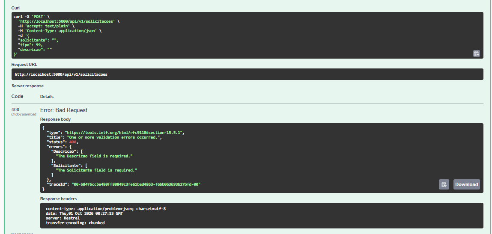
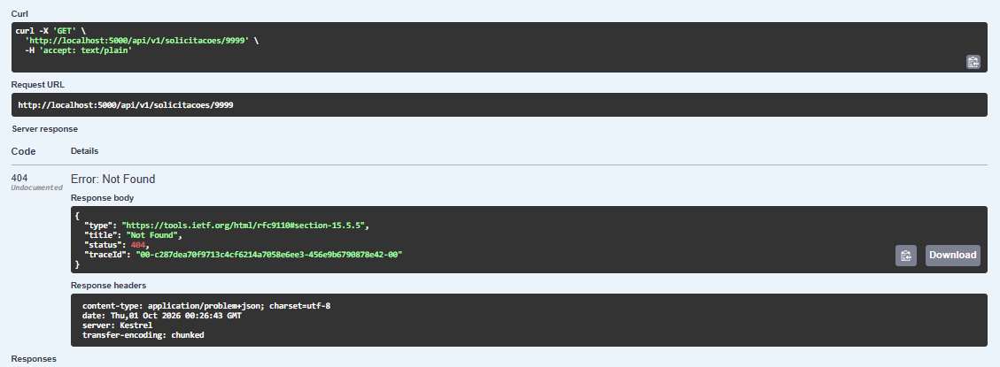

# Solicitações Internas

API RESTful desenvolvida em C# com .NET 10 para o gerenciamento de solicitações internas de uma empresa.

## Integrantes

- Werbeth Nunes — RM 559067
- Thamiris Almeida — RM 559155
- Fabrini Soares — RM 557813
- Guilherme Cezarino Simões — RM 557724

## 1. Contexto

O projeto tem como objetivo facilitar o registro e o acompanhamento de solicitações realizadas por funcionários de uma empresa.

Solicitações de TI, manutenção, materiais e acessos podem ser realizadas por diferentes meios, dificultando seu controle e acompanhamento. A aplicação centraliza essas informações, permitindo o cadastro, consulta, atualização e exclusão das solicitações.

## 2. Público-alvo

Empresas que necessitam organizar e acompanhar solicitações internas realizadas por seus funcionários.

## 3. Tecnologias utilizadas

- C#
- .NET 10
- ASP.NET Core Web API
- Entity Framework Core
- SQLite
- Swagger

## 4. Banco de dados

Foi utilizado o **SQLite** como banco de dados da aplicação.

Arquivo do banco:

`solicitacoes_internas.db`

## 5. Como executar

### Pré-requisitos

- .NET 10 SDK
- Visual Studio, Visual Studio Code ou Rider

### Restaurar os pacotes

```bash
dotnet restore
```

### Instalar o Entity Framework Core CLI

Caso ainda não esteja instalado:

```bash
dotnet tool install --global dotnet-ef
```

### Criar a Migration

```bash
dotnet ef migrations add InitialCreate
```

### Atualizar o banco de dados

```bash
dotnet ef database update
```

### Executar a aplicação

```bash
dotnet run
```

Após iniciar a aplicação, o Swagger estará disponível no endereço apresentado pelo terminal.

Exemplo:

`http://localhost:5000/swagger`

## 6. Endpoints

A API utiliza a versão `v1`.

| Método | Rota | Descrição |
|---|---|---|
| GET | `/api/v1/solicitacoes` | Retorna todas as solicitações. |
| GET | `/api/v1/solicitacoes/{id}` | Retorna uma solicitação pelo ID. |
| GET | `/api/v1/solicitacoes/status/{status}` | Retorna solicitações pelo status. |
| POST | `/api/v1/solicitacoes` | Cadastra uma nova solicitação. |
| PUT | `/api/v1/solicitacoes/{id}` | Atualiza uma solicitação. |
| DELETE | `/api/v1/solicitacoes/{id}` | Exclui uma solicitação. |

## 7. Tipos de solicitação

| Valor | Tipo |
|---|---|
| `0` | TI |
| `1` | Manutencao |
| `2` | Material |
| `3` | Acesso |
| `4` | Outros |

## 8. Status das solicitações

| Valor | Status |
|---|---|
| `0` | Aberta |
| `1` | EmAnalise |
| `2` | Atendida |
| `3` | Cancelada |

Fluxo da solicitação:

`Aberta → EmAnalise → Atendida`

ou

`Aberta → EmAnalise → Cancelada`

## 9. Exemplo de requisição POST

```json
{
  "solicitante": "João Silva",
  "tipo": 0,
  "descricao": "Computador não está ligando"
}
```

O status inicial e a data da solicitação são definidos pela API.

## 10. Entity Framework Core

O projeto utiliza o Entity Framework Core para realizar o acesso e a persistência dos dados no banco SQLite.

A aplicação possui um `DbContext` para a comunicação com o banco de dados.

## 11. Migration

Foi criada a Migration inicial do projeto:

```bash
dotnet ef migrations add InitialCreate
```

Para aplicar a Migration ao banco:

```bash
dotnet ef database update
```

A pasta `Migrations` está presente no projeto.

## 12. Códigos de resposta HTTP

| Código | Descrição |
|---|---|
| `200 OK` | Requisição processada com sucesso. |
| `201 Created` | Recurso criado com sucesso. |
| `204 No Content` | Recurso excluído com sucesso. |
| `400 Bad Request` | Dados inválidos ou incompletos. |
| `404 Not Found` | Recurso não encontrado. |

## 13. Evidências dos testes

Os testes foram realizados utilizando o Swagger. As capturas de tela estão disponíveis na pasta `evidencias`.

### GET — Listagem



### GET — Busca por ID



### GET — Busca por status



### POST — Cadastro



### PUT — Atualização



### DELETE — Exclusão



### 400 — Bad Request



### 404 — Not Found


